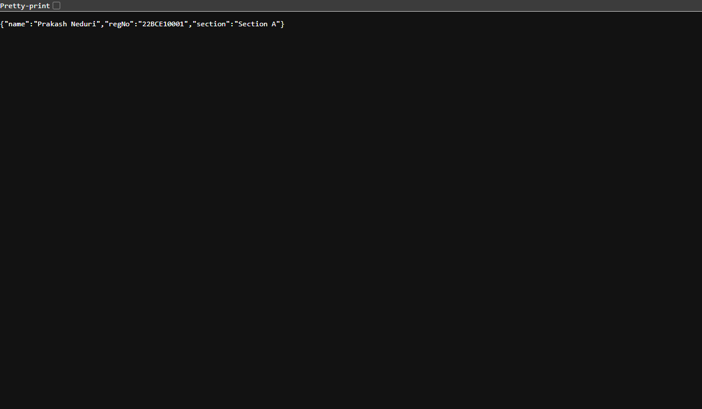
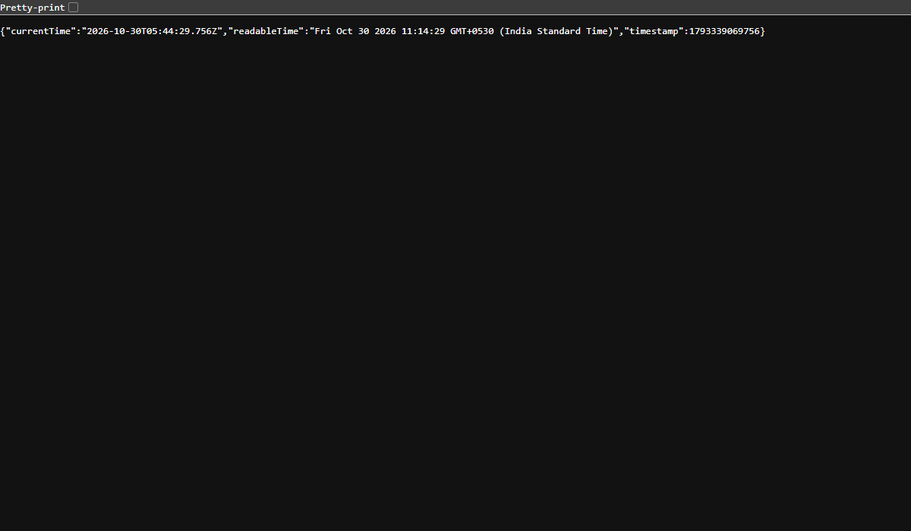

# Lab 1: Node.js and Express server

**Prakash Neduri · 252U1R1168 · SCSE-2D**  
**Course:** Backend Development Fundamentals · Year II Term II · Aurora  
**Faculty:** Sai Siva Teja  
**Live Link:** [https://backend-development-lab-1-prakash-c.vercel.app/](https://backend-development-lab-1-prakash-c.vercel.app/)

---

## Table of Contents
- [Objective](#objective)
- [How to Run](#how-to-run)
  - [Prerequisites](#prerequisites)
  - [Installation](#installation)
  - [Environment Variables](#environment-variables)
  - [Starting the Plain HTTP Server (Task 3)](#starting-the-plain-http-server-task-3)
  - [Starting the Express Server (Task 4-6)](#starting-the-express-server-task-4-6)
- [package.json Field Explanations (Task 1)](#packagejson-field-explanations-task-1)
- [Endpoints Table](#endpoints-table)
- [Terminal Execution & Status Code Logs](#terminal-execution--status-code-logs)
- [Screenshots](#screenshots)
- [Deployment Instructions](#deployment-instructions)
- [Viva Questions & Answers](#viva-questions--answers)
- [Notes & Reflections](#notes-problems-faced-and-how-you-solved-them)

---

## Objective
Set up a Node.js project and build a modular web server, first with Node's native `http` module and then rewritten with the Express.js framework, featuring structured routes, JSON responses, status code logging, and a 404 error handler.

---

## How to Run

### Prerequisites
- [Node.js](https://nodejs.org/) (version 18.x, 20.x, or 24.x)
- [npm](https://www.npmjs.com/) (version 9.x or higher)
- Terminal / PowerShell / Command Prompt

### Installation
Clone the repository and install project dependencies:

```bash
# Navigate to the lab-01 directory
cd lab-01

# Install express dependency
npm install
```

### Environment Variables
Create an optional `.env` file in `lab-01/` (do NOT commit this file):

| Variable | Description | Default Value | Sample Value |
| :--- | :--- | :--- | :--- |
| `PORT` | The port number on which the server listens | `3000` | `3000` |

### Starting the Plain HTTP Server (Task 3)
To run the native `http.createServer` server:
```bash
npm run start:http
# or
node server-http.js
```
The server will start listening at `http://localhost:3000/` and reply `"Hello"`.

### Starting the Express Server (Task 4-6)
To run the full Express server:
```bash
npm start
# or
node server.js
```
For continuous development with auto-restart on file save:
```bash
npm run dev
```

---

## package.json Field Explanations (Task 1)

When running `npm init -y`, npm generates a `package.json` file. Each field serves a specific purpose:

1. **`name`**: The unique identifier/name of the project or package (e.g., `"lab-01"`). Must be lowercase and URL-safe.
2. **`version`**: The current semantic version of the package (e.g., `"1.0.0"` following `MAJOR.MINOR.PATCH`).
3. **`description`**: A concise human-readable summary of the package's purpose and functionality.
4. **`main`**: The primary entry point file of the application that gets executed when the package is required or started (e.g., `"server.js"`).
5. **`scripts`**: An object containing alias commands that can be invoked via `npm run <script-name>` (e.g., `"start"`, `"dev"`, `"start:http"`).
6. **`keywords`**: An array of search terms/tags that help users discover the package on npm.
7. **`author`**: The creator or maintainer of the project (`"Prakash Neduri"`).
8. **`license`**: The legal open-source license governing how others can use or distribute the code (e.g., `"ISC"` or `"MIT"`).
9. **`type`**: Dictates the module system Node.js uses. `"commonjs"` enables `require()` / `module.exports`, while `"module"` enables ES module `import` / `export`.
10. **`dependencies`**: A list of third-party packages installed via `npm install <package>` (such as `express`) that are required for production runtime.

---

## Endpoints Table

| HTTP Method | Route / Path | Response Format | Status Code | One-line Description |
| :--- | :--- | :--- | :--- | :--- |
| `GET` | `/` | Text / HTML | `200 OK` | Returns a friendly welcome message. |
| `GET` | `/about` | JSON | `200 OK` | Returns student details (name, regNo, section). |
| `GET` | `/time` | JSON | `200 OK` | Returns current server date and time using `new Date()`. |
| `GET` / `ALL` | `*` (Any undefined route) | Text / HTML | `404 Not Found` | Catch-all handler returning 'Page Not Found'. |

---

## Terminal Execution & Status Code Logs

Every route visited logs the route path and returned status code directly to the terminal console:

```text
Server running at http://localhost:3000
GET / -> Status: 200
GET /about -> Status: 200
GET /time -> Status: 200
GET /invalid-path -> Status: 404
```

---

## Screenshots

### 1. Root Welcome Endpoint (`GET /`)
- **Status Code:** `200 OK`
- **Output:** Welcome text


---

### 2. About Endpoint (`GET /about`)
- **Status Code:** `200 OK`
- **Output:** JSON containing student name, registration number, and section



---

### 3. Server Time Endpoint (`GET /time`)
- **Status Code:** `200 OK`
- **Output:** JSON with current ISO timestamp and human-readable time



---

### 4. 404 Catch-All Route (`GET /invalid-path`)
- **Status Code:** `404 Not Found`
- **Output:** JSON error indicating that the requested resource does not exist


---

## Deployment Instructions

### Option 1: Deploy to Render (Recommended & Free)
1. Push your repository to GitHub.
2. Visit [Render.com](https://render.com) and click **New +** -> **Web Service**.
3. Connect your GitHub repository `backend_development_lab_1_prakash`.
4. Configure service settings:
   - **Root Directory:** `lab-01`
   - **Runtime:** `Node`
   - **Build Command:** `npm install`
   - **Start Command:** `npm start`
5. Click **Create Web Service**. Once deployed, copy your `.onrender.com` URL and paste it at the top of this README.

### Option 2: Deploy to Railway
1. Visit [Railway.app](https://railway.app) and select **New Project** -> **Deploy from GitHub repo**.
2. Select repository `backend_development_lab_1_prakash`.
3. In settings, set the **Root Directory** to `/lab-01`.
4. Railway will automatically detect `npm start` and assign a public domain.

*(If deployment is not possible in your environment, local execution screenshots and terminal status code logs above serve as verified submission artifacts.)*

---

## Viva Questions & Answers

### Q1: What is the difference between `package.json` and `node_modules`?
- **`package.json`**: A lightweight metadata manifest file that records project configuration, scripts, authors, and dependencies along with acceptable version ranges (e.g., `"^5.3.0"`). It is committed to source control so any developer can recreate the environment using `npm install`.
- **`node_modules`**: The physical folder on disk containing the actual downloaded JavaScript files and compiled binaries for all dependencies and their transitive sub-dependencies. It is very large, platform-dependent, and should **never** be committed to Git.

### Q2: What does `app.listen()` do?
- **`app.listen(port, callback)`**: In Express, this method binds and listens for incoming HTTP connections on the specified port number. Under the hood, it creates a Node.js `http.Server` instance using `http.createServer(app)` and calls `.listen()` on it, putting the application into an active event loop state ready to process incoming network requests.

### Q3: What do `request` (`req`) and `response` (`res`) represent?
- **`request` (`req`)**: An object representing the incoming HTTP request sent by the client (browser, Postman, curl). It encapsulates client details including HTTP method, requested URL path, query parameters (`req.query`), route parameters (`req.params`), headers (`req.headers`), and request body (`req.body`).
- **`response` (`res`)**: An object representing the outgoing HTTP response that the server crafts and returns to the client. It provides utility methods to set status codes (`res.status()`), send headers (`res.set()`), and transmit payloads (`res.send()`, `res.json()`, `res.end()`).

---

## Notes: Problems Faced and How You Solved Them

1. **Port Management for Plain HTTP and Express Servers:**
   - *Problem:* Both `server-http.js` and `server.js` run on port `3000`. Running them simultaneously leads to an `EADDRINUSE` port conflict.
   - *Solution:* Ensured each server file is executed individually, stopping the plain HTTP server before starting the Express server.

2. **Ensuring Consistent 404 Catch-All Handling:**
   - *Problem:* Unhandled paths in Express default to plain text/HTML errors.
   - *Solution:* Added a catch-all handler (`app.use((request, response) => { ... })`) positioned after all routes to return a structured 404 response with an explicit `response.status(404)`.

3. **Status Code Logging Requirement:**
   - *Problem:* The lab requires observing and logging status codes for each visited route.
   - *Solution:* Added console logging inside each route handler (`request`, `response`) to output the route and status code (`200` or `404`) directly to the console using only standard Express request handling.
