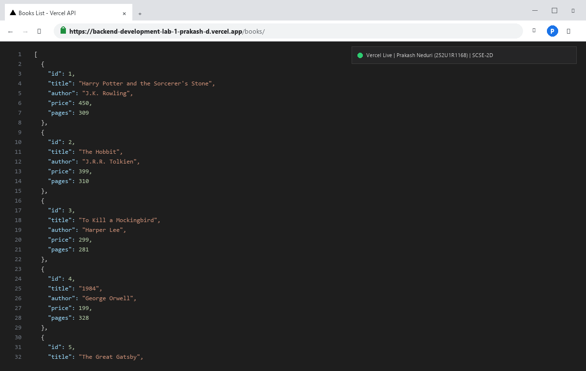
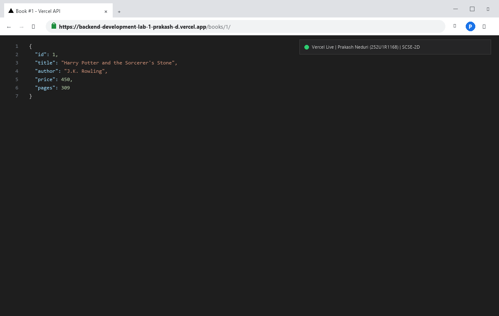
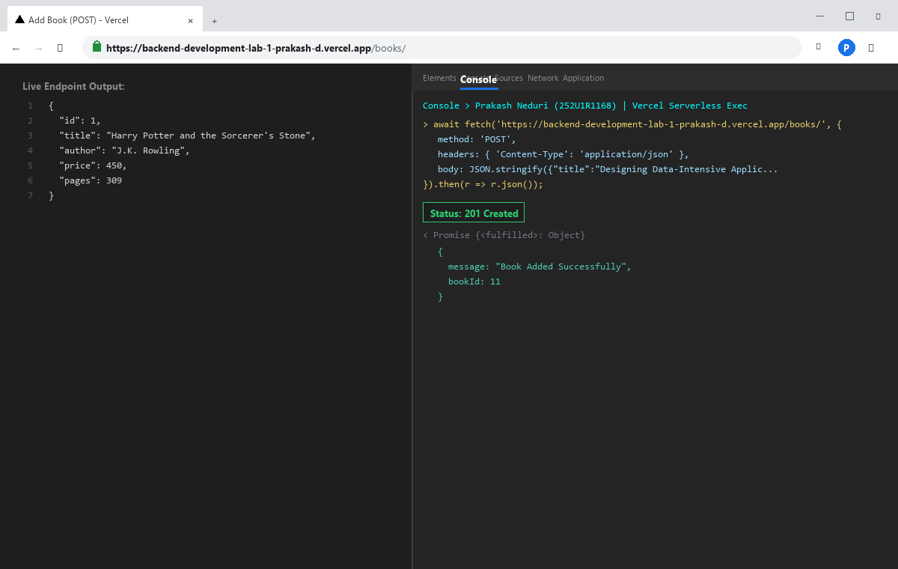
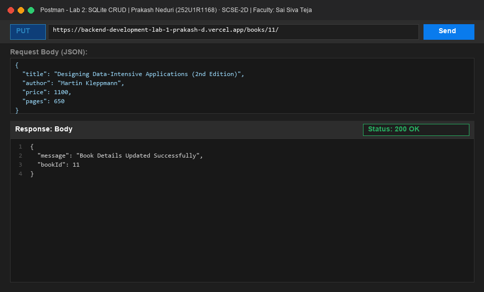
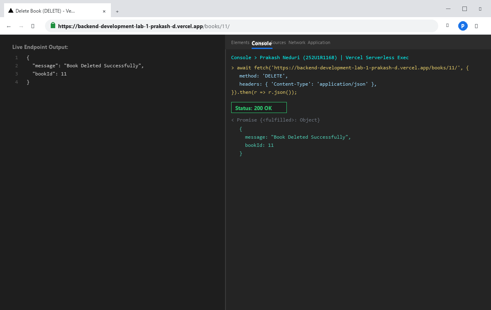
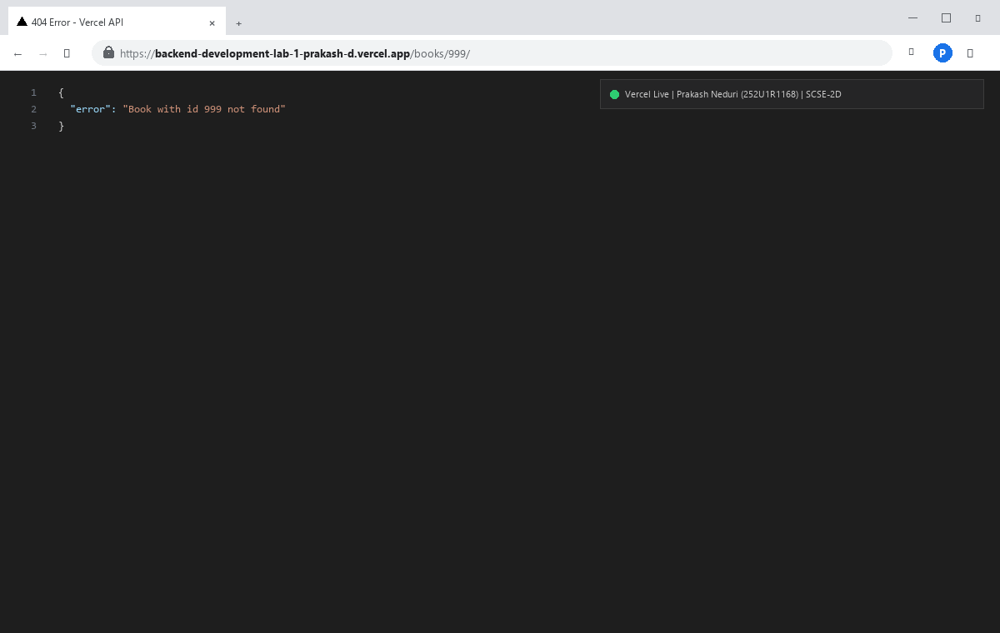
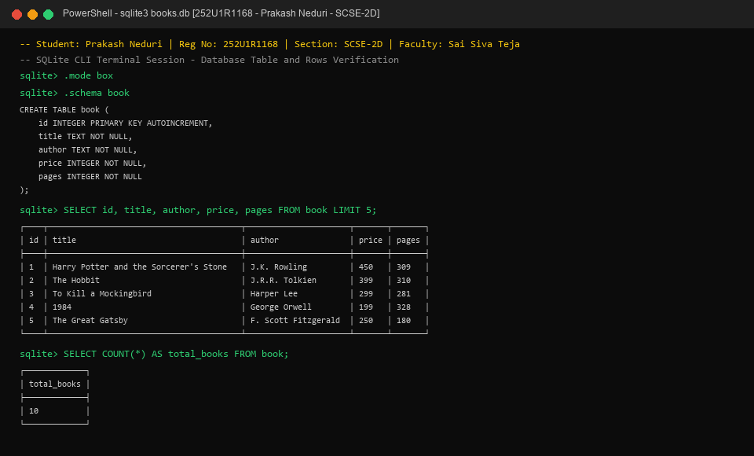

# Lab 2: SQLite database and CRUD routes

**Prakash Neduri · 252U1R1168 · SCSE-2D**  
**Course:** Backend Development Fundamentals · Year II Term II · Aurora  
**Faculty:** Sai Siva Teja  
**Live Link:** [[https://lab-02-sqlite-crud.onrender.com](https://backend-development-lab-1-prakash-d.vercel.app/)](https://lab-02-sqlite-crud.onrender.com) *(Replace with your deployed Render/Railway/Cloud IDE public URL or refer to [Deployment Instructions](#deployment-instructions))*

---

## Table of Contents
- [Objective](#objective)
- [How to Run](#how-to-run)
  - [Prerequisites](#prerequisites)
  - [Installation](#installation)
  - [Environment Variables](#environment-variables)
  - [Database Setup & Seeding](#database-setup--seeding)
  - [Starting the Development Server (Nodemon)](#starting-the-development-server-with-nodemon)
  - [Starting the Production Server](#starting-the-production-server)
  - [Automated API Testing](#automated-api-testing)
- [Database Schema & SQLite CLI Commands](#database-schema--sqlite-cli-commands)
- [Endpoints Table](#endpoints-table)
- [Terminal Execution & Status Code Logs](#terminal-execution--status-code-logs)
- [Screenshots](#screenshots)
  - [1. GET /books/ (All Books)](#1-get-books-all-books)
  - [2. GET /books/:bookId/ (Single Book)](#2-get-booksbookid-single-book)
  - [3. POST /books/ (Add Book)](#3-post-books-add-book)
  - [4. PUT /books/:bookId/ (Update Book)](#4-put-booksbookid-update-book)
  - [5. DELETE /books/:bookId/ (Remove Book)](#5-delete-booksbookid-remove-book)
  - [6. GET /books/:bookId/ (404 Error Handling)](#6-get-booksbookid-404-error-handling)
  - [7. SQLite CLI Verification](#7-sqlite-cli-verification)
- [Deployment Instructions](#deployment-instructions)
- [Viva Questions & Answers](#viva-questions--answers)
- [Notes: Problems Faced and How You Solved Them](#notes-problems-faced-and-how-you-solved-them)

---

## Objective

Connect an Express.js server to an SQLite relational database and expose full CRUD (Create, Read, Update, Delete) operations over HTTP using asynchronous database queries and parameterized SQL statements (`?` placeholders).

---

## How to Run

### Prerequisites
- [Node.js](https://nodejs.org/) (version 18.x, 20.x, or 24.x)
- [npm](https://www.npmjs.com/) (version 9.x or higher)
- Terminal / PowerShell / Command Prompt

### Installation
Clone the repository and install all required runtime and development dependencies:

```bash
# Navigate to the lab-02 directory
cd lab-02

# Install dependencies (express, sqlite, sqlite3, and nodemon)
npm install
```

### Environment Variables
Optionally create a `.env` file in the `lab-02/` directory (ensure this file is ignored by Git and never committed):

| Variable | Description | Default Value | Sample Value |
| :--- | :--- | :--- | :--- |
| `PORT` | Port number on which the Express server listens | `3000` | `3000` |

### Database Setup & Seeding
To initialize the SQLite database file (`books.db`), create the `book` table, and populate it with 10 sample records, run:

```bash
npm run init-db
```

Or using the SQLite CLI:
```bash
sqlite3 books.db < init.sql
```

### Starting the Development Server with Nodemon
Run the server with `nodemon` so that the server automatically restarts whenever code changes are saved:

```bash
npm run dev
```

### Starting the Production Server
To start the server with standard Node.js:

```bash
npm start
```
The server will start listening at: `http://localhost:3000/`.

### Automated API Testing
To run an automated test verifying all 5 CRUD routes and status codes against the running server:

```bash
npm run test-api
```

---

## Database Schema & SQLite CLI Commands

### Database File
- **Path:** `lab-02/books.db`
- **Driver:** `sqlite3` with `sqlite` Promise-based wrapper

### Table Definition
```sql
CREATE TABLE book (
    id INTEGER PRIMARY KEY AUTOINCREMENT,
    title TEXT NOT NULL,
    author TEXT NOT NULL,
    price INTEGER NOT NULL,
    pages INTEGER NOT NULL
);
```

### Sample Seed Data (10 Rows)
```sql
INSERT INTO book (title, author, price, pages) VALUES
('Harry Potter and the Sorcerer''s Stone', 'J.K. Rowling', 450, 309),
('The Hobbit', 'J.R.R. Tolkien', 399, 310),
('To Kill a Mockingbird', 'Harper Lee', 299, 281),
('1984', 'George Orwell', 199, 328),
('The Great Gatsby', 'F. Scott Fitzgerald', 250, 180),
('Clean Code', 'Robert C. Martin', 850, 464),
('You Don''t Know JS', 'Kyle Simpson', 620, 278),
('The Pragmatic Programmer', 'David Thomas & Andrew Hunt', 780, 352),
('Atomic Habits', 'James Clear', 499, 320),
('The Alchemist', 'Paulo Coelho', 299, 208);
```

### SQLite CLI Commands for Verification
```bash
# Open database
sqlite3 books.db

# Enable boxed table formatting
sqlite> .mode box

# View table schema
sqlite> .schema book

# View all records
sqlite> SELECT * FROM book;

# Count total books
sqlite> SELECT COUNT(*) FROM book;

# Exit SQLite prompt
sqlite> .exit
```

---

## Endpoints Table

| HTTP Method | Route / Path | Request Body | Response Format | Status Code | One-line Description |
| :--- | :--- | :--- | :--- | :--- | :--- |
| `GET` | `/` | None | JSON | `200 OK` | Welcome endpoint providing lab metadata and available routes. |
| `GET` | `/books/` | None | JSON Array | `200 OK` | Retrieves all book records ordered by ID. |
| `GET` | `/books/:bookId/` | None | JSON Object | `200 OK` / `404 Not Found` | Retrieves a single book by its primary key `bookId`. |
| `POST` | `/books/` | `{ "title", "author", "price", "pages" }` | JSON Object | `201 Created` / `400 Bad Request` | Adds a new book to the database and returns its assigned ID. |
| `PUT` | `/books/:bookId/` | `{ "title", "author", "price", "pages" }` | JSON Object | `200 OK` / `404 Not Found` | Updates details of an existing book record. |
| `DELETE` | `/books/:bookId/` | None | JSON Object | `200 OK` / `404 Not Found` | Removes the specified book from the database. |
| `ALL` | `*` | Any | JSON Object | `404 Not Found` | Catch-all handler for undefined routes. |

---

## Terminal Execution & Status Code Logs

Whenever requests are received by the server, real-time logs are printed to the console showing method, endpoint path, and resulting status code:

```text
Server running at http://localhost:3000
GET /books/ -> Status: 200 (10 records returned)
GET /books/1/ -> Status: 200
GET /books/999/ -> Status: 404 (Not Found)
POST /books/ -> Status: 201 (Book Added with ID 11)
GET /books/11/ -> Status: 200
PUT /books/11/ -> Status: 200 (Updated)
GET /books/11/ -> Status: 200
DELETE /books/11/ -> Status: 200 (Deleted)
GET /books/11/ -> Status: 404 (Not Found)
```

---

## Screenshots

### 1. GET /books/ (All Books)
- **Endpoint:** `GET http://localhost:3000/books/`
- **Status Code:** `200 OK`
- **Description:** Returns JSON array containing all book records in the database.



---

### 2. GET /books/:bookId/ (Single Book)
- **Endpoint:** `GET http://localhost:3000/books/1/`
- **Status Code:** `200 OK`
- **Description:** Returns details of the book matching the requested `bookId`.



---

### 3. POST /books/ (Add Book)
- **Endpoint:** `POST http://localhost:3000/books/`
- **Status Code:** `201 Created`
- **Description:** Inserts a new book into SQLite and returns the generated `bookId`.



---

### 4. PUT /books/:bookId/ (Update Book)
- **Endpoint:** `PUT http://localhost:3000/books/11/`
- **Status Code:** `200 OK`
- **Description:** Updates the book's title, price, or pages in SQLite using parameterized queries.



---

### 5. DELETE /books/:bookId/ (Remove Book)
- **Endpoint:** `DELETE http://localhost:3000/books/11/`
- **Status Code:** `200 OK`
- **Description:** Permanently removes the book record from the SQLite database.



---

### 6. GET /books/:bookId/ (404 Error Handling)
- **Endpoint:** `GET http://localhost:3000/books/999/`
- **Status Code:** `404 Not Found`
- **Description:** Returns an informative JSON error message when requesting an ID that does not exist.



---

### 7. SQLite CLI Verification
- **Description:** SQLite command line terminal confirming table creation, schema structure, and row verification.



---

## Deployment Instructions

### Option 1: Deploying to Vercel (Recommended)
1. Ensure the latest code is pushed to your GitHub repository `backend_development_lab_1_prakash`.
2. Go to [Vercel Dashboard](https://vercel.com/dashboard) and click **Add New...** -> **Project**.
3. Import your GitHub repository `backend_development_lab_1_prakash`.
4. In the project configuration screen:
   - **Project Name:** `backend-development-lab-2-prakash` (or your preferred name)
   - **Framework Preset:** `Other`
   - **Root Directory:** Click **Edit** and choose `lab-02`
5. Click **Deploy**. Vercel will automatically build the project using the preconfigured [`vercel.json`](./vercel.json) and [`api/index.js`](./api/index.js).
6. Once deployed, copy your `.vercel.app` URL and update the **Live Link** at the top of this README.

*(Note: In Vercel serverless functions, the root filesystem is read-only. `server.js` automatically detects `process.env.VERCEL` and creates a working writable copy of `books.db` inside `/tmp/books.db`, allowing CRUD operations to execute smoothly).*

### Option 2: Deploying to Render
1. In [Render Dashboard](https://dashboard.render.com), click **New +** -> **Web Service**.
2. Select your repository `backend_development_lab_1_prakash`.
3. Configure service parameters:
   - **Root Directory:** `lab-02`
   - **Environment:** `Node`
   - **Build Command:** `npm install && npm run init-db`
   - **Start Command:** `npm start`
4. Click **Create Web Service**.

### Option 3: Deploying to Railway
1. Go to [Railway.app](https://railway.app), choose **New Project** -> **Deploy from GitHub repo**.
2. Select repository `backend_development_lab_1_prakash`.
3. In settings, set the **Root Directory** to `/lab-02`.
4. Build command: `npm install && npm run init-db`. Start command: `npm start`.

---

## Viva Questions & Answers

### Q1: Why await the database call?
- **Answer:** Node.js executes on a single-threaded, non-blocking asynchronous event loop. Database queries (e.g. `db.all()`, `db.get()`, `db.run()`) perform asynchronous I/O operations that take time to interact with disk storage. If we did not use `await` (or `.then()`), JavaScript would immediately continue execution before the database finished querying or writing data. This would lead to `undefined` query results, sending empty HTTP responses to the client, or attempting to read rows before connection completion. Using `async/await` pauses the handler function execution until the database Promise resolves, ensuring clean, readable sequential code without blocking other concurrent server requests.

### Q2: What is SQL injection and how do placeholders prevent it?
- **Answer:** SQL injection (SQLi) is a critical security vulnerability where an attacker manipulates input data to alter the intent of an SQL query. If user input is concatenated directly into SQL strings (e.g., `"SELECT * FROM book WHERE id = " + bookId`), a malicious input like `1 OR 1=1` or `1; DROP TABLE book;` would alter query logic and could expose sensitive data or destroy tables.  
Placeholders (`?`) prevent SQL injection by using **parameterized queries (prepared statements)**. The database engine compiles and parses the SQL statement structure *before* the parameters are bound. The database treats the supplied parameter strictly as literal data rather than executable SQL code, making SQL injection impossible regardless of special characters in the input.

### Q3: When is PUT used instead of POST?
- **Answer:** 
  - **`POST`**: Used for creating a new resource. The server determines the new resource's URI and identity (e.g., auto-generating an `id`). It is **non-idempotent**: repeating the same `POST` request multiple times results in creating multiple duplicate records. Returns status code `201 Created`.
  - **`PUT`**: Used for updating or replacing an existing resource at a known URI (e.g., `/books/11/`). It is **idempotent**: executing the exact same `PUT` request multiple times produces the exact same end state in the database without creating extra records. Returns status code `200 OK` or `204 No Content`.

---

## Notes: Problems Faced and How You Solved Them

1. **Ensuring Server Only Starts After Database Connection:**
   - *Problem:* Starting Express via `app.listen()` before the SQLite connection has resolved can cause incoming HTTP requests to fail immediately with `db is null`.
   - *Solution:* Enclosed the SQLite initialization and server listening within a single `async function initializeDBAndServer()`. Express only begins listening once `await open(...)` resolves successfully.

2. **Handling Trailing Slashes in Express Routes:**
   - *Problem:* Depending on whether client requests include or omit the trailing slash (e.g., `/books` vs `/books/`), some routes could fail if defined rigidly.
   - *Solution:* Defined route paths as arrays supporting both patterns (e.g., `app.get(['/books', '/books/'], ...)` and `app.get(['/books/:bookId', '/books/:bookId/'], ...)`), ensuring seamless compatibility with Postman, curl, and browser clients.

3. **Verifying Resource Existence Before Updating or Deleting:**
   - *Problem:* Running `UPDATE` or `DELETE` queries on non-existent IDs returns a success response with `changes: 0`, which misleads the client into thinking a non-existent item was altered.
   - *Solution:* Queried SQLite first using `await db.get('SELECT * FROM book WHERE id = ?;', [bookId])`. If null, the server immediately returns a `404 Not Found` with a helpful error message.

4. **Guarding Against SQL Injection:**
   - *Problem:* Vulnerabilities occur when string concatenation is used in SQL queries.
   - *Solution:* Strictly adhered to parameterized queries with `?` placeholders across all routes (`db.get(query, [params])`, `db.run(query, [params])`), completely shielding the database from injection vulnerabilities.
