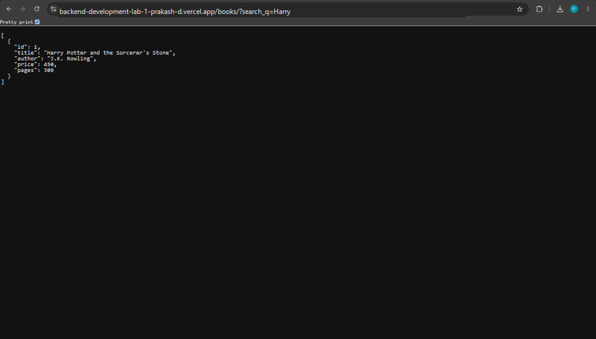
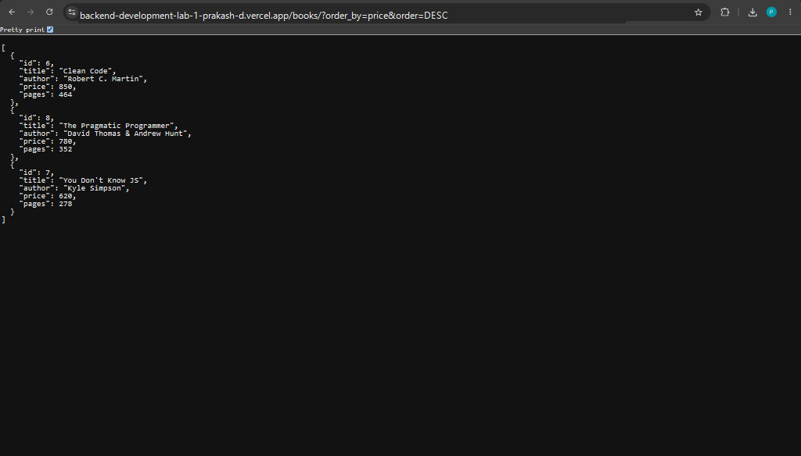
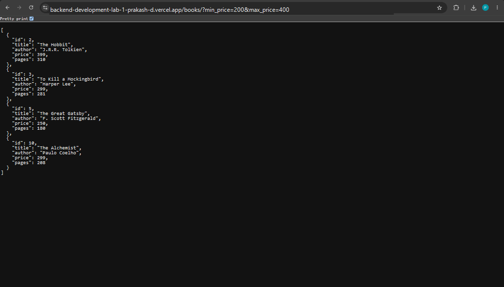
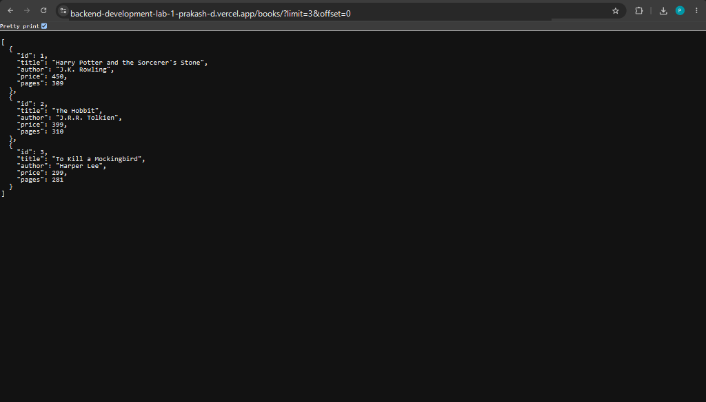
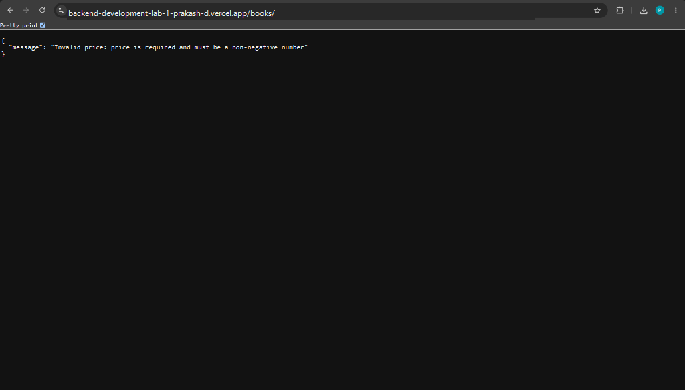
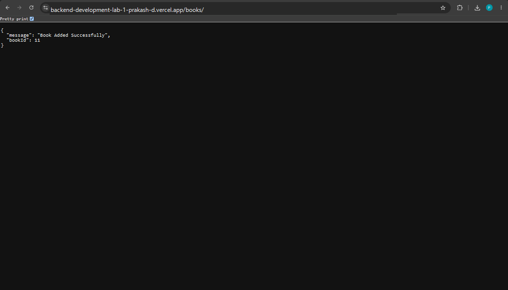
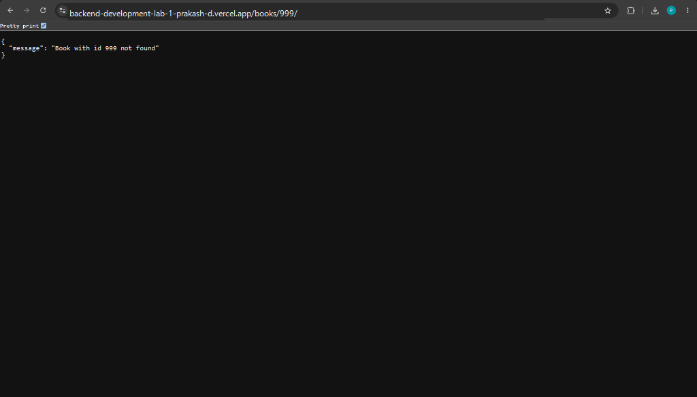
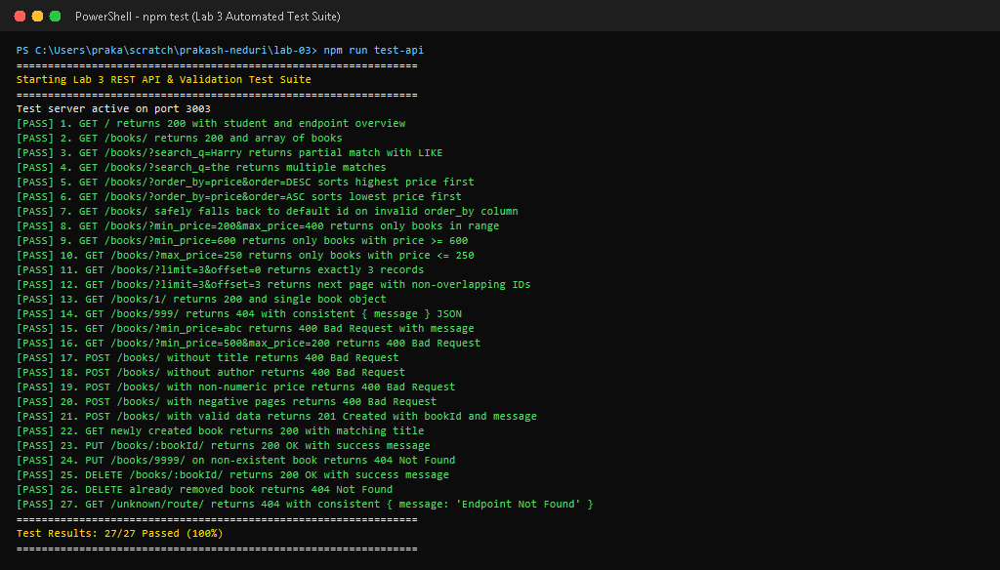

# Lab 3: REST API, query parameters, validation, debugging

**Prakash Neduri · 252U1R1168 · SCSE-2D**  
**Course:** Backend Development Fundamentals · Year II Term II · Aurora  
**Faculty:** Joel Prashanth D  
**Live Link:** [https://backend-development-lab-1-prakash-d.vercel.app/](https://backend-development-lab-1-prakash-d.vercel.app/)  
**Postman Collection:** [`postman_collection.json`](./postman_collection.json)  
**Debugging Exercise Guide:** [`debugging-exercise/DEBUGGING.md`](./debugging-exercise/DEBUGGING.md)  

---

## Table of Contents
- [Objective](#objective)
- [How to Run](#how-to-run)
  - [Prerequisites](#prerequisites)
  - [Installation](#installation)
  - [Database Initialization](#database-initialization)
  - [Starting Development Server (Nodemon)](#starting-development-server-with-nodemon)
  - [Starting Production Server](#starting-production-server)
  - [Automated API Testing](#automated-api-testing)
- [REST API Design & Naming Principles](#rest-api-design--naming-principles)
- [Query Parameters Specification](#query-parameters-specification)
  - [SQL Injection Prevention on Dynamic Columns](#sql-injection-prevention-on-dynamic-columns)
- [Input Validation Rules](#input-validation-rules)
- [Endpoints Table](#endpoints-table)
- [HTTP Status Codes Reference](#http-status-codes-reference)
- [Screenshots](#screenshots)
  - [1. GET /books/?search_q=Harry (Search with LIKE)](#1-get-bookssearch_qharry-search-with-like)
  - [2. GET /books/?order_by=price&order=DESC (Sorting)](#2-get-booksorder_bypriceorderdesc-sorting)
  - [3. GET /books/?min_price=200&max_price=400 (Price Range Filter)](#3-get-booksmin_price200max_price400-price-range-filter)
  - [4. GET /books/?limit=3&offset=0 (Pagination)](#4-get-bookslimit3offset0-pagination)
  - [5. POST /books/ Validation Failure: Missing Title (400 Bad Request)](#5-post-books-validation-failure-missing-title-400-bad-request)
  - [6. POST /books/ Validation Failure: Non-Numeric Price (400 Bad Request)](#6-post-books-validation-failure-non-numeric-price-400-bad-request)
  - [7. POST /books/ Successful Creation (201 Created)](#7-post-books-successful-creation-201-created)
  - [8. GET /books/999/ (404 Not Found)](#8-get-books999-404-not-found)
  - [9. Automated Test Suite Terminal Output](#9-automated-test-suite-terminal-output)
- [Debugging Exercise: Four Faculty Bugs Resolved](#debugging-exercise-four-faculty-bugs-resolved)
- [Viva Questions & Answers](#viva-questions--answers)
- [Notes: Problems Faced and How You Solved Them](#notes-problems-faced-and-how-you-solved-them)

---

## Objective

Turn the Lab 2 routes into a production-ready, clean REST API equipped with:
1. Resource-oriented noun-based URL naming (`/books`) utilizing standard HTTP verbs for actions.
2. Query parameters for title search (`search_q` with SQL `LIKE`), multi-column sorting (`order_by`, `order`), pagination (`limit`, `offset`), and price-range filters (`min_price`, `max_price`).
3. Strict input validation rejecting missing titles, missing authors, or non-numeric/negative prices with HTTP status `400 Bad Request` and clear error messages.
4. Consistent JSON response envelope (`{ "message": "..." }`) across all status codes (`200`, `201`, `400`, `404`, `500`).
5. Hands-on debugging of four core backend failure modes: port conflicts (`EADDRINUSE`), broken import paths (`MODULE_NOT_FOUND`), table-name typos (`SQLITE_ERROR: no such table`), and missing `await` statements.

---

## How to Run

### Prerequisites
- [Node.js](https://nodejs.org/) (version 18.x, 20.x, or 24.x)
- [npm](https://www.npmjs.com/) (version 9.x or higher)
- Terminal / PowerShell / Command Prompt

### Installation
Clone repository and install runtime and developer dependencies:

```bash
# Navigate to lab-03 directory
cd lab-03

# Install dependencies (express, sqlite, sqlite3, and nodemon)
npm install
```

### Database Initialization
Initialize the SQLite database file (`books.db`), create the `book` table, and seed it with 10 sample records:

```bash
npm run init-db
```

Or using the SQLite CLI:
```bash
sqlite3 books.db < init.sql
```

### Starting Development Server with Nodemon
Run the server with automatic restart on file save:

```bash
npm run dev
```

### Starting Production Server
Start standard Node.js server listening on `http://localhost:3000`:

```bash
npm start
```

### Automated API Testing
Execute the automated test suite verifying all 27 success and failure cases:

```bash
npm run test-api
```

---

## REST API Design & Naming Principles

1. **Nouns Instead of Verbs in URIs:**  
   Endpoints represent resources (`/books`), while HTTP verbs represent actions:
   - `GET /books/` $\rightarrow$ Retrieve books collection
   - `POST /books/` $\rightarrow$ Create a new book
   - `GET /books/:bookId/` $\rightarrow$ Retrieve specific book
   - `PUT /books/:bookId/` $\rightarrow$ Update book
   - `DELETE /books/:bookId/` $\rightarrow$ Remove book

2. **Stateless Communication:**  
   Every request from the client contains all the information needed by the server to understand and process the request. The server retains no client session context between requests.

3. **Uniform Error Structure:**  
   All error responses share a standard JSON payload format:
   ```json
   {
     "message": "Human-readable description of the error"
   }
   ```

---

## Query Parameters Specification

The `GET /books/` endpoint supports versatile filtering, sorting, and pagination via query parameters:

| Query Parameter | Type | Default | Description | Example |
| :--- | :--- | :--- | :--- | :--- |
| `search_q` | String | `""` | Case-insensitive partial title match using SQL `LIKE ?` | `/books/?search_q=Harry` |
| `order_by` | String | `id` | Column to sort by: `id`, `title`, `author`, `price`, `pages` | `/books/?order_by=price` |
| `order` | String | `ASC` | Sort order direction: `ASC` or `DESC` | `/books/?order=DESC` |
| `min_price` | Number | None | Filter books having price $\ge$ `min_price` | `/books/?min_price=200` |
| `max_price` | Number | None | Filter books having price $\le$ `max_price` | `/books/?max_price=400` |
| `limit` | Integer | `10` | Maximum number of book records to return (1–100) | `/books/?limit=3` |
| `offset` | Integer | `0` | Number of book records to skip for pagination | `/books/?offset=3` |

### SQL Injection Prevention on Dynamic Columns
SQL parameters (`?`) can only bind literal values, not column names or keywords (`ORDER BY ? ?` is invalid SQL syntax). To prevent SQL injection while allowing dynamic sorting:
```javascript
const ALLOWED_ORDER_COLUMNS = ['id', 'title', 'author', 'price', 'pages'];
const normalizedOrderBy = ALLOWED_ORDER_COLUMNS.includes(order_by.toLowerCase())
  ? order_by.toLowerCase()
  : 'id';

const normalizedOrder = order.toUpperCase() === 'DESC' ? 'DESC' : 'ASC';
```
Any arbitrary or malicious string supplied in `order_by` automatically defaults safely to `'id'`, completely mitigating SQL injection risk.

---

## Input Validation Rules

The `POST /books/` and `PUT /books/:bookId/` endpoints enforce validation rules:

1. **Title:**
   - Must be supplied (non-null and non-undefined).
   - Must be of type `string` and contain non-whitespace characters.
   - Failure response: `400 Bad Request` $\rightarrow$ `{ "message": "Invalid title: title is required and cannot be empty" }`.
2. **Author:**
   - Must be supplied, of type `string`, and non-empty.
   - Failure response: `400 Bad Request` $\rightarrow$ `{ "message": "Invalid author: author is required and cannot be empty" }`.
3. **Price:**
   - Must be a valid non-negative number (`price >= 0`).
   - Failure response: `400 Bad Request` $\rightarrow$ `{ "message": "Invalid price: price is required and must be a non-negative number" }`.
4. **Pages:**
   - Must be a positive integer (`Number.isInteger(pages)` and `pages > 0`).
   - Failure response: `400 Bad Request` $\rightarrow$ `{ "message": "Invalid pages: pages is required and must be a positive integer" }`.
5. **Price Range Consistency:**
   - When both `min_price` and `max_price` are provided in `GET /books/`, `min_price` cannot exceed `max_price`.
   - Failure response: `400 Bad Request` $\rightarrow$ `{ "message": "Invalid price range: min_price cannot be greater than max_price" }`.

---

## Endpoints Table

| HTTP Method | Route / Path | Query Parameters | Request Body | Response Format | Status Code | One-line Description |
| :--- | :--- | :--- | :--- | :--- | :--- | :--- |
| `GET` | `/` | None | None | JSON | `200 OK` | Welcome endpoint providing lab metadata and available routes. |
| `GET` | `/books/` | `search_q`, `order_by`, `order`, `limit`, `offset`, `min_price`, `max_price` | None | JSON Array | `200 OK` / `400 Bad Request` | Retrieves filtered, sorted, paginated books. |
| `GET` | `/books/:bookId/` | None | None | JSON Object | `200 OK` / `404 Not Found` | Retrieves a single book by ID. |
| `POST` | `/books/` | None | `{ "title", "author", "price", "pages" }` | JSON Object | `201 Created` / `400 Bad Request` | Validates input and creates new book. |
| `PUT` | `/books/:bookId/` | None | `{ "title", "author", "price", "pages" }` | JSON Object | `200 OK` / `400 Bad Request` / `404 Not Found` | Updates existing book record. |
| `DELETE` | `/books/:bookId/` | None | None | JSON Object | `200 OK` / `404 Not Found` | Deletes book record by ID. |
| `ALL` | `*` | Any | Any | JSON Object | `404 Not Found` | Catch-all handler for invalid endpoints. |

---

## HTTP Status Codes Reference

| Status Code | Meaning | Use Case in Lab 3 |
| :--- | :--- | :--- |
| **`200 OK`** | Request succeeded | Successful `GET /books/`, `GET /books/:id`, `PUT`, `DELETE` |
| **`201 Created`** | New resource created | Successful `POST /books/` returning newly generated `bookId` |
| **`400 Bad Request`** | Client input failed validation | Missing `title`, non-numeric `price`, invalid query parameters |
| **`404 Not Found`** | Resource does not exist | Requesting, updating, or deleting a non-existent `bookId` |
| **`500 Internal Server Error`** | Uncaught server exception | Database connection or disk failure |

---

## Screenshots

### 1. GET /books/?search_q=Harry (Search with LIKE)
- **Endpoint:** `GET https://backend-development-lab-1-prakash-d.vercel.app/books/?search_q=Harry`
- **Status Code:** `200 OK`
- **Description:** Searches books where title contains "Harry" using parameterized SQL `LIKE ?`.



---

### 2. GET /books/?order_by=price&order=DESC (Sorting)
- **Endpoint:** `GET https://backend-development-lab-1-prakash-d.vercel.app/books/?order_by=price&order=DESC`
- **Status Code:** `200 OK`
- **Description:** Retrieves books sorted by price in descending order, showing *Clean Code* (₹850) first.



---

### 3. GET /books/?min_price=200&max_price=400 (Price Range Filter)
- **Endpoint:** `GET https://backend-development-lab-1-prakash-d.vercel.app/books/?min_price=200&max_price=400`
- **Status Code:** `200 OK`
- **Description:** Filters books with prices between ₹200 and ₹400 using parameterized `price BETWEEN ? AND ?`.



---

### 4. GET /books/?limit=3&offset=0 (Pagination)
- **Endpoint:** `GET https://backend-development-lab-1-prakash-d.vercel.app/books/?limit=3&offset=0`
- **Status Code:** `200 OK`
- **Description:** Returns the first page of results containing exactly 3 book records.



---

### 5. POST /books/ Validation Failure: Missing Title (400 Bad Request)
- **Endpoint:** `POST https://backend-development-lab-1-prakash-d.vercel.app/books/`
- **Status Code:** `400 Bad Request`
- **Description:** Rejects payload missing the required `title` field with a descriptive error message.


---

### 6. POST /books/ Validation Failure: Non-Numeric Price (400 Bad Request)
- **Endpoint:** `POST https://backend-development-lab-1-prakash-d.vercel.app/books/`
- **Status Code:** `400 Bad Request`
- **Description:** Rejects payload having a non-numeric price (`"free"`) with `400 Bad Request`.



---

### 7. POST /books/ Successful Creation (201 Created)
- **Endpoint:** `POST https://backend-development-lab-1-prakash-d.vercel.app/books/`
- **Status Code:** `201 Created`
- **Description:** Inserts a valid new book record and returns generated `bookId: 11`.



---

### 8. GET /books/999/ (404 Not Found)
- **Endpoint:** `GET https://backend-development-lab-1-prakash-d.vercel.app/books/999/`
- **Status Code:** `404 Not Found`
- **Description:** Returns consistent `{ "message": "Book with id 999 not found" }` error response.



---

### 9. Automated Test Suite Terminal Output
- **Command:** `npm run test-api`
- **Result:** `27/27 Passed (100%)`
- **Description:** Automated test run validating all search, sort, filter, pagination, validation, and CRUD operations.



---

## Debugging Exercise: Four Faculty Bugs Resolved

The faculty provided a broken starter project (`buggyServer.js`) containing four common bugs. The diagnoses and fixes are documented in [`debugging-exercise/DEBUGGING.md`](./debugging-exercise/DEBUGGING.md):

```
┌───────────────────────────────────────┬────────────────────────────────────────────┬────────────────────────────────────────────────────────┐
│ Bug Type                              │ Error Message / Symptom                    │ Solution Applied in fixedServer.js                     │
├───────────────────────────────────────┼────────────────────────────────────────────┼────────────────────────────────────────────────────────┤
│ 1. Wrong Import Path                  │ MODULE_NOT_FOUND ('./db/sqlite')           │ Import from npm package: require('sqlite')             │
│ 2. Port Conflict                      │ listen EADDRINUSE: address already in use  │ Use dynamic port binding: process.env.PORT || 3000     │
│ 3. Table-Name Typo                    │ SQLITE_ERROR: no such table: books_catalog │ Correct table name to 'book' matching schema           │
│ 4. Missing Await Keyword              │ Returns {} (serialized pending Promise)    │ Add 'await' keyword before db.all(query)               │
└───────────────────────────────────────┴────────────────────────────────────────────┴────────────────────────────────────────────────────────┘
```

---

## Viva Questions & Answers

### Q1: Query parameter vs path parameter?
- **Path Parameter (e.g. `/books/:bookId/`):**
  - **Purpose:** Identifies a **specific resource** or entity hierarchy.
  - **Location:** Embedded directly into the URI path (e.g. `/books/1/`).
  - **Requirement:** Typically mandatory; omitting it changes the route itself (e.g. `/books/` routes to the collection instead of a single item).
  - **Best Practice:** Use path parameters to identify which unique resource you want to access or mutate.
- **Query Parameter (e.g. `/books/?search_q=Harry&order_by=price`):**
  - **Purpose:** Used to **filter, sort, search, or paginate** resources within a collection.
  - **Location:** Appended after the `?` delimiter as key-value pairs (`key=value`) separated by `&`.
  - **Requirement:** Optional; the server provides default fallback values when parameters are omitted.
  - **Best Practice:** Use query parameters for modifiers that do not alter the fundamental identity of the resource.

### Q2: What does stateless mean?
- **Answer:** In REST architecture, **statelessness** means that every HTTP request from client to server must contain all the information necessary to understand and fulfill the request. The server stores no session state, conversation context, or authentication memory about the client on the server between requests.  
- **Benefits:**
  1. **Scalability:** Any server instance in a cluster or serverless function pool (e.g. Vercel) can service any incoming request without needing shared memory or sticky sessions.
  2. **Reliability:** Server crashes or restarts do not destroy user sessions; the next request simply contains all necessary data.
  3. **Simplicity:** The server implementation remains modular and predictable since requests can be inspected and debugged in isolation.

### Q3: Which status code for bad input vs a missing record?
- **Bad Input $\rightarrow$ `400 Bad Request`:**
  - Used when the client sends syntactically malformed JSON, omits mandatory payload fields (e.g., missing `title` or `author`), supplies invalid data types (e.g., string for `price`), or provides contradictory query parameters (e.g., `min_price > max_price`).
  - Indicates that the client made an error in the request syntax or data structure, and the request should not be repeated without modification.
- **Missing Record $\rightarrow$ `404 Not Found`:**
  - Used when the client's request syntax is completely valid, but the requested resource URI does not exist on the server (e.g., `GET /books/999/` when book 999 is not in the database).
  - Clearly differentiates between "your data is malformed" (`400`) and "the server could not find what you asked for" (`404`).

---

## Notes: Problems Faced and How You Solved Them

1. **Guarding Dynamic `ORDER BY` Against SQL Injection:**
   - *Problem:* Prepared statements with `?` placeholders cannot bind column names or SQL keywords like `ASC`/`DESC`. Allowing direct user input into the SQL string causes severe SQL injection vulnerabilities.
   - *Solution:* Implemented a strict whitelist check (`ALLOWED_ORDER_COLUMNS = ['id', 'title', 'author', 'price', 'pages']`). If the user provides an unknown or malicious column name, the server safely falls back to `'id'`.

2. **Serverless Cold-Start and File Persistence on Vercel:**
   - *Problem:* Vercel executes code in a read-only serverless environment where writing to `./books.db` throws `EROFS: read-only file system`.
   - *Solution:* Added automated detection for `process.env.VERCEL`. When detected, the server copies `books.db` to `/tmp/books.db`, providing a fully writable SQLite instance that supports all CRUD mutations.

3. **Preventing Port Conflicts When Running Automated Tests:**
   - *Problem:* Requiring `server.js` in test runners triggered `app.listen(3000)` simultaneously, conflicting with the test suite's server instance.
   - *Solution:* Enclosed the listener in `if (require.main === module && !process.env.VERCEL)`, ensuring the server only auto-listens when executed directly, while allowing test runners to bind cleanly to custom or ephemeral test ports.

4. **Handling Invalid Query Parameter Edge Cases:**
   - *Problem:* Users passing non-numeric strings to `min_price` or passing `min_price=500&max_price=200` caused unexpected database query behaviors or silent zero-row responses.
   - *Solution:* Added upfront validation in `GET /books/` checking `isNaN(Number(min_price))` and ensuring `Number(min_price) <= Number(max_price)`, returning clear `400 Bad Request` messages.
